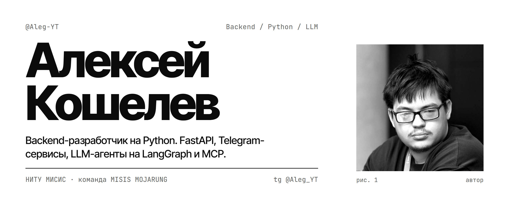
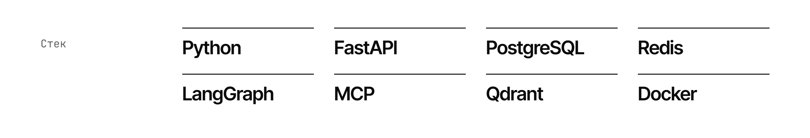
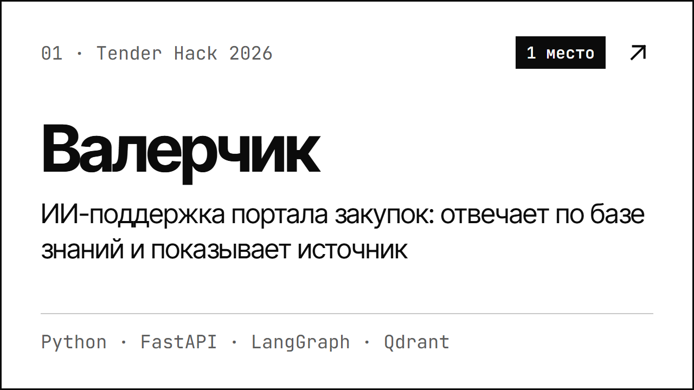
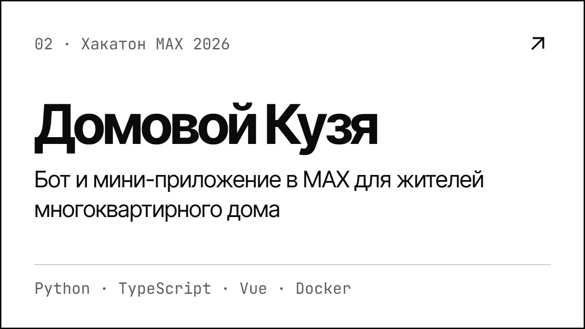
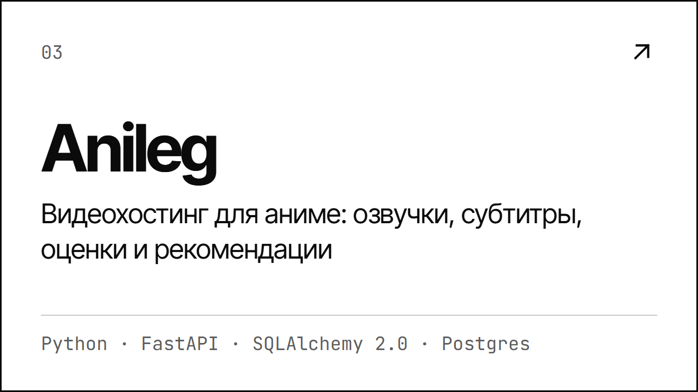
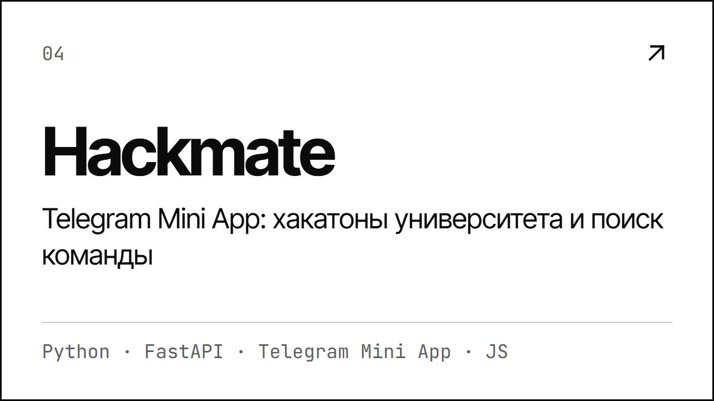
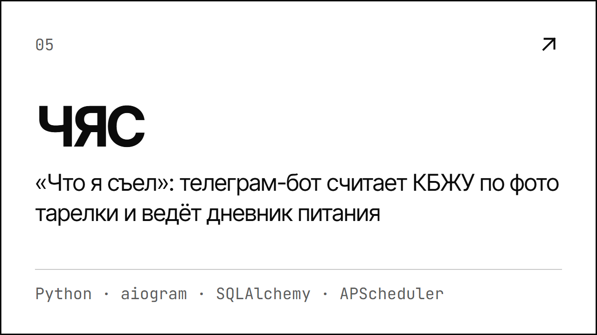
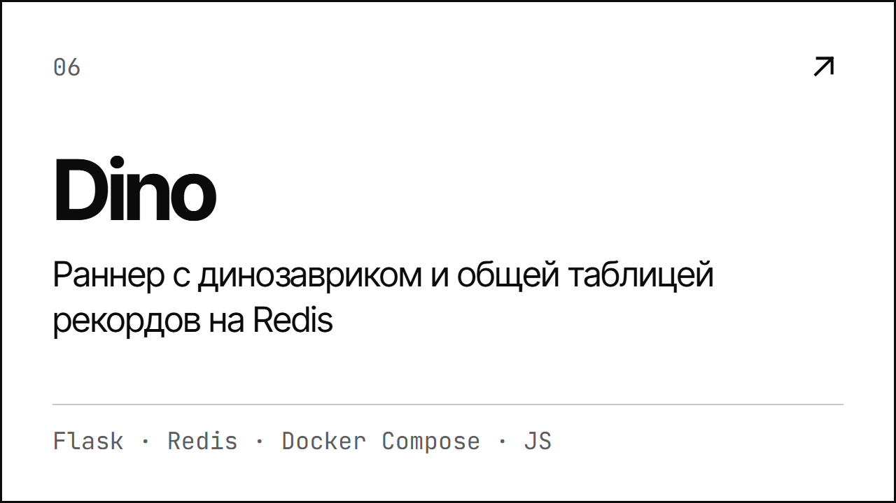
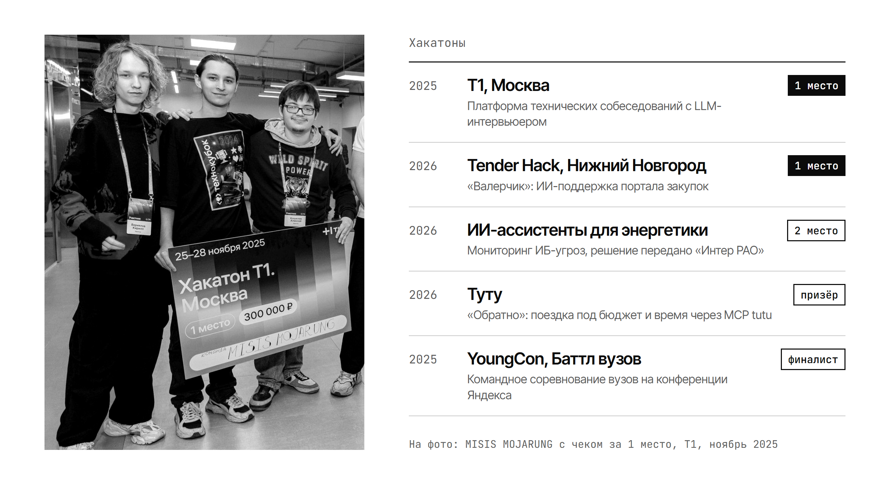
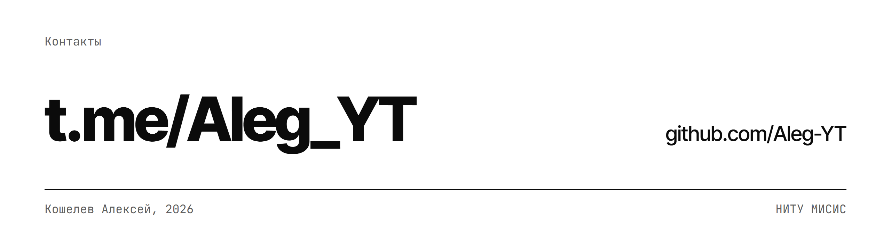

<picture>
  <source media="(prefers-color-scheme: dark)" srcset="assets/hero-dark.png">
  
</picture>

<picture>
  <source media="(prefers-color-scheme: dark)" srcset="assets/stack-dark.png">
  
</picture>

<a href="https://github.com/Aleg-YT/valerchik-qwen-Tender_NN26-"><picture><source media="(prefers-color-scheme: dark)" srcset="assets/01-valerchik-dark.png"></picture></a>
<a href="https://github.com/Aleg-YT/max_hack"><picture><source media="(prefers-color-scheme: dark)" srcset="assets/02-kuzya-dark.png"></picture></a>

<a href="https://github.com/Aleg-YT/anileg"><picture><source media="(prefers-color-scheme: dark)" srcset="assets/03-anileg-dark.png"></picture></a>
<a href="https://github.com/Aleg-YT/hackmate"><picture><source media="(prefers-color-scheme: dark)" srcset="assets/04-hackmate-dark.png"></picture></a>

<a href="https://github.com/Aleg-YT/chyas-bot"><picture><source media="(prefers-color-scheme: dark)" srcset="assets/05-chyas-dark.png"></picture></a>
<a href="https://github.com/Aleg-YT/Dino_game"><picture><source media="(prefers-color-scheme: dark)" srcset="assets/06-dino-dark.png"></picture></a>

<picture>
  <source media="(prefers-color-scheme: dark)" srcset="assets/hackathons-dark.png">
  
</picture>

<a href="https://t.me/Aleg_YT"><picture>
  <source media="(prefers-color-scheme: dark)" srcset="assets/footer-dark.png">
  
</picture></a>
